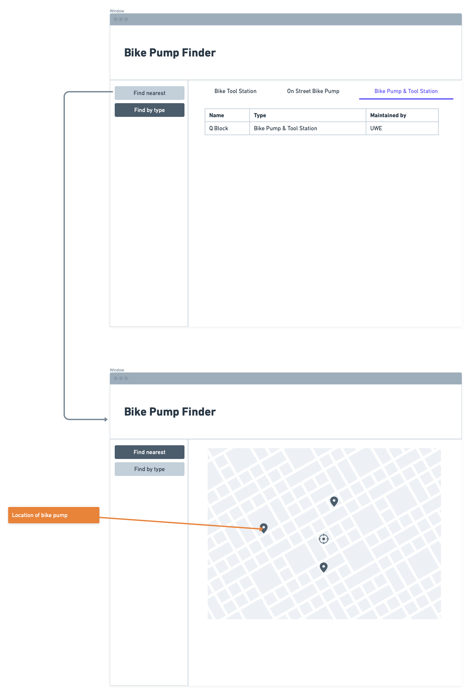

# Design

## User Interface design
The wireframe shows the planned design of Bristol Toilet Finder. The website will have a clear title, a search box, facility filters and a list of public toilets. Each toilet will show its address, opening hours and available facilities. The design aims to be simple and easy to use for residents and visitors in Bristol.

TODO: repeat as necessary
